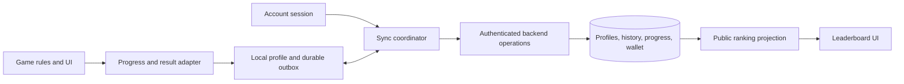

# Optional accounts and progression design

Status: Design baseline; implementation under code review
Date: November 7, 2026  
Scope: Microgame Madness browser application

Related document: [Implementation plan](accounts-and-progression-plan.md), drafted against the proposed defaults below.

Optional accounts let players preserve their arcade progress, continue on another device, and participate under a persistent identity. Guest play remains a complete experience. The proposed foundation extends the existing Supabase integration while preserving the static website and shared Python game rules.

The first release should demonstrate one complete journey: a guest earns progress, creates an account, and continues on another device with the same achievements, Cash, equipment, unlocks, and settings. Reliable sync and migration are the principal engineering work. Richer rankings and social features build on that foundation.

This specification defines behavior, data boundaries, review decisions, and acceptance criteria. The [implementation status](accounts-implementation-status.md) records the delivered scope and remaining hosted release gates; the implementation plan defines ownership and verification work.

## Goals and boundaries

### Goals

- Preserve immediate play without registration or a network dependency on the account service.
- Offer recoverable accounts and progress across browsers and devices.
- Preserve existing players' progress through an explicit, recoverable migration.
- Record individual game results and support useful personal history and statistics.
- Make retries, simultaneous devices, and account switching safe for progress and Cash.
- Extend rankings with persistent identity, personal placement, seasons, and clear eligibility rules.
- Keep private account data separate from public arcade identity.
- Establish contracts that later implementation work can divide without competing definitions of identity, rewards, or sync.

### Initial exclusions

- Python desktop/terminal account integration.
- Multiplayer gameplay, chat, direct messages, trading, gifting, and real-money purchases.
- Saving an active fight and resuming it on another device.
- Guaranteed offline startup or installation as a PWA. Offline progress support applies when the game and runtime are available; the current first load requires network downloads.
- Competitive anti-cheat guarantees or a rewrite of the game engine.
- Full reconstruction of historical rounds from existing aggregate saves.

## Existing system

| Area | Current behavior | Design consequence |
| --- | --- | --- |
| Hosting and gameplay | Static site; JavaScript UI; shared Python rules executed through Pyodide | Accounts can be added without changing hosting or putting gameplay requests in the frame loop |
| Local profile | One `microgame-madness.v1` browser save contains scores, achievement statistics, unlocks, Cash, purchases, and equipment | Separate guest and account stores are necessary before account switching |
| Local names | Best scores can appear under several nicknames; achievements and wallet belong to the shared browser profile | A nickname cannot establish ownership of legacy progress |
| Cloud identity | Leaderboard client creates an anonymous Supabase user when needed and persists its session separately | Guest conversion should preserve this identity when possible |
| Rankings | Best per identity, mode, and difficulty; public top ten; browser-computed scores | Reuse identity and ranking foundations; distinguish casual acceptance from gameplay verification |
| Retry queue | Keeps the highest pending score per mode and difficulty | A history and rewards queue must retain distinct operations, including lower-scoring runs |
| Progress | Some counters update during play; others come from Cubie interactions, secrets, music, and page time | Completed-round records alone cannot represent progression |
| Practice | King's Wrath has its own scores; temporary Core practice has selected progress rewards but no saved scores or Cash | Eligibility must be defined by mode and event, not a generic practice flag |
| Settings | Some preferences are session-only; reduced motion follows the device | Define which preferences sync and which remain device-specific |

The repository contains the integration and migrations. Deployment configuration, applied migrations, auth settings, email delivery, and production data require an environment audit before implementation rollout.

Source references: [browser profile and game integration](../web/app.js), [leaderboard client](../web/leaderboards.js), [initial leaderboard schema](../supabase/migrations/20261101000000_leaderboards.sql), [achievements](../web/achievements.js), [shop](../web/shop.js), [browser adapter](../web/bridge.py), and [hosting and backend setup](game-and-development-reference.md#connect-the-global-leaderboards).

## Player experience

### Guest and account capabilities

| Capability | Guest | Signed in |
| --- | --- | --- |
| Games, achievements, cosmetics, secrets | Available | Available |
| Saves | This browser | Local cache plus cloud persistence |
| History | Recent local history | Persistent account history |
| Leaderboard browsing | Available | Available, including personal placement |
| Casual submissions | Optional, using an anonymous identity | Optional, using the account identity |
| Preferences | Local | Synced preferences with local device overrides |
| Recovery after clearing storage | No guaranteed recovery | Sign in again to recover acknowledged cloud data |

Account creation must not gate game access, earned cosmetics, or ordinary achievements. Future online-only challenges may require a connection and persistent identity if their rules explicitly say so.

### Profile entry point

Add a compact profile control near the existing player setup. A guest sees “Guest · Saved on this device” with **Save my progress** and **Sign in**. A signed-in player sees their Cubie, display name, and save status. Keep prompts outside active play; a nonblocking reminder after a meaningful milestone is acceptable, with dismissal remembered.

The profile surface contains overview, history, achievements, appearance, settings, and account controls. The current round's score and game controls remain immediately accessible. On small screens, use a full-height panel or page with clear back navigation; on larger screens, use the existing sidebar or an expanded profile panel. Do not add many tabs to the narrow sidebar without checking their mobile layout.

Initial profile content includes personal bests by game, recently earned achievements, latest results, equipped Cubie and trail, and saved settings. History filters use game, difficulty, and outcome. Date labels follow the viewer's locale; the underlying timestamps retain UTC values.

### Settings scope

| Setting | Account behavior | Device behavior |
| --- | --- | --- |
| Sound enabled | Save the preferred default | Allow a local override; browser audio activation still requires a user gesture |
| Reduced motion | Optional preference to reduce motion everywhere | Always honor the operating system's reduced-motion request; sync cannot force animation back on |
| Cubie and trail | Sync equipped choices after validating ownership | Render only effects supported by local accessibility preferences |
| Default game and difficulty | Optional remembered choice | Never auto-start a round when restored |
| Catalog filters and panel state | Keep local initially | Preserve convenience without causing cross-device layout changes |
| Touch layout and future control mappings | Keep local initially | Different input devices may need different controls |
| Public visibility and ranking participation | Server-backed account preferences | Apply restrictions to every client and public read |

Use existing game defaults when a preference is absent. Resetting preferences does not reset achievements, currency, purchases, or history. Secret unlocks and one-time hint acknowledgements are progression, not settings. New controls such as arbitrary key remapping are outside the initial scope; the storage design should leave room for them.

### Save states

| State | Player-facing behavior |
| --- | --- |
| Guest saved | “Saved on this device” |
| Account caught up | “Saved” and a last successful sync time in details |
| Pending operations | “Syncing…” without blocking gameplay |
| Network unavailable | “Offline · Progress saved on this device” |
| Session cannot refresh | “Sign in again to sync”; retain queued operations under their original owner |
| Operation rejected | Explain the affected change and recovery action; preserve unrelated progress |
| Local storage unavailable | “Progress lasts for this visit unless saved online”; never imply a durable queue exists |
| Local capacity exhausted | Warn that new offline progress cannot be durably queued; offer export or reconnect, without discarding earlier pending work |

“Saved” means the relevant operations have been acknowledged by the server. A successful local write alone must not produce that label for a cloud account.

### Sign in and recovery

Proposed first provider: email with a one-time code. It keeps confirmation within the existing game tab and avoids password reset UX. Google sign-in is a later addition unless review prioritizes it. Email confirmation, resend throttling, expired codes, changed email addresses, and account recovery must have deliberate flows.

Creating an account from an anonymous identity links a verified sign-in identity to that user wherever supported. Signing into an existing account is a different flow and may require a controlled transfer of guest data. A successful authentication must not silently replace or merge the guest save.

Supabase supports anonymous identity conversion and email codes, but conversion and existing-account conflicts need distinct application handling. See [anonymous sign-ins](https://supabase.com/docs/guides/auth/auth-anonymous) and [passwordless email](https://supabase.com/docs/guides/auth/auth-email-passwordless).

Opening account UI during a round pauses modes that support pausing. Account switches and imports take effect between rounds. For a mode that cannot pause, defer the flow until the round ends or the player deliberately exits; do not change its timing rules.

### Public identity and secrets

Use an internal immutable player ID for ownership. Display names remain editable and need not be unique. Public profiles, if enabled, use a separate opaque public identifier; neither email nor the auth user ID appears in ranking responses or URLs.

Move secret entry into an **Arcade codes** control shared by guests and accounts. Preserve existing code effects, unlocks, celebration behavior, and hints. Editing a public name must not accidentally execute a secret or publish a code as the player's name. Any compatibility transition for the old name field must be reviewed with existing secret-related tests.

Public profile browsing is off by default. Leaderboard participation is a separate opt-in that publishes the display name, permitted Cubie appearance, score, and rank. A player may participate in rankings without publishing their history or achievement collection. Turning participation off hides existing public entries and prevents new publication; private bests remain.

## Architecture and ownership

Retain the static site and Supabase Auth/Postgres. Add trusted backend operations for transactional changes and identity transfer. A small server function may perform verification or orchestration that cannot safely run in the browser; the choice of SQL RPC versus hosted function is an implementation decision constrained by the contracts below.

| Boundary | Responsibility |
| --- | --- |
| Account/session | One auth session shared by saves and rankings; sign-in, refresh, sign-out, identity transitions |
| Local profile store | Versioned guest/account caches, durable outbox, migrations, backups, device preferences |
| Progress adapter | Convert game and arcade events into stable operations while preserving current reward semantics |
| Sync coordinator | Retry, owner checks, acknowledgement, conflict handling, and refreshing cached projections |
| Backend commands | Authenticate owner, validate payload, deduplicate, and atomically apply accepted changes |
| Read projections | Efficient profile, history, wallet, and ranking reads with controlled public fields |
| Presentation | Profile, save state, migration review, account flows, and ranking navigation |

Proposed local storage: IndexedDB for structured caches, histories, and an outbox committed in the same transaction as local state changes. Use the supported auth client's storage mechanism for session credentials. Small device preferences may remain in localStorage. Import the legacy save without requiring users to clear it.

There must be one session authority; the current leaderboard client must not continue independently creating or refreshing a competing identity. The session adapter should use the supported Supabase client where practical. Existing custom session compatibility must be evaluated before replacing its stored format.

Account network requests never run in the gameplay frame loop. Upload semantic events at checkpoints or in bounded batches, and read profile changes on reconnect, focus, or explicit refresh. Realtime subscriptions are optional later.

## Logical data model

Names below describe logical entities, not final SQL or public API names.

| Entity | Important fields and constraints |
| --- | --- |
| Account profile | Auth owner, public identifier, display name, visibility and ranking participation, revision |
| Preferences | Owner, preference values and per-field revisions; device overrides are local |
| Device and stream | Random installation/stream identifiers, owner binding, sequence; identifiers are not credentials |
| Run | Unique run ID, owner, game/mode, difficulty, outcome, score, duration, versions, local occurrence time, server receipt time, eligibility and provenance |
| Progress event | Operation ID, owner, stream sequence, optional run ID, typed payload, schema version |
| Progress projection | Counters, unlocks and earned dates, streak state, catalog version, revision |
| Wallet transaction | Unique source operation, integer amount, reason, balance effect, server time |
| Inventory | Unique owner/item pair, source, ownership time; separate equipped selection |
| Import receipt | Source migration ID, destination owner, manifest digest, applied categories, resulting revisions |
| Ranking best | Owner, board identity, eligible source run or legacy record, score, tie time, visibility |
| Season and board | Game, difficulty, scoring ruleset, time window, acceptance deadline, trust category |
| Operation receipt | Unique owner/operation ID, payload digest, accepted/rejected result and revision |

Prefer queryable columns for ownership, routing, versions, score, and timestamps. Bounded JSON is appropriate for mode-specific statistics and evolving preferences. Avoid making a single unvalidated profile JSON document the database's authoritative record.

Keep separate versions for transport schema, local storage schema, gameplay/scoring rules, reward rules, and achievement catalog. A visual-only change should not automatically split rankings. A change that affects comparable scores must map to an explicit board policy.

Server-derived profile points come from earned achievement IDs and the catalog's point policy; never accept an arbitrary points total. Preserve the current behavior that retiering can change profile points unless review chooses a different policy. Cosmetic ownership must distinguish achievement unlocks, purchases, and special code entitlements.

## Results and progression semantics

### Run lifecycle

Generate a run ID before accepting gameplay input, and bind it to the active profile and stream. Record start, meaningful progress checkpoints, and one final outcome. Retries cannot create another completion or another reward. A reused operation ID with different content is a conflict, not a new operation.

Outcome values distinguish win, loss, voluntary exit, and interruption. Reloading an unfinished run marks it interrupted when recovered; it does not fabricate a completed loss. Server history can retain that interruption without counting it as a completed game. A crash before local persistence may leave no recoverable result; do not manufacture statistics to fill gaps.

The result payload contains bounded mode-specific facts such as damage taken, attacks survived, or typing rounds. Client occurrence times describe personal history; server receipt times govern ingestion and applicable competition deadlines. Neither client timestamps nor durations are trusted proof of play.

### Eligibility rules

| Activity | History | Cash and best scores | Progress |
| --- | --- | --- | --- |
| Normal completed game | Win/loss result | Existing mode reward and best-score rules | Existing achievements and completion counters |
| Key Rush voluntary exit | Exit result | Preserve its existing score/Cash behavior; explicitly permit it on applicable casual boards | Preserve current typing progress; do not count as a completed win/loss |
| Other unfinished game | Exit/interruption, optionally hidden by default | No new completion reward or final ranking submission | Retain progress already earned under existing rules; apply abandonment rules |
| King's Wrath | Result under the specific attack or Random Order | Existing separate rewards and boards | Existing Wrath and shared attack-survival progression |
| Full Singularity Core | Private result | Existing local reward/best behavior; no new global board by default | Existing Core progression |
| Temporary Core practice | Practice activity, separate from completed-game totals | No Cash or score board | Preserve eligible attack survivals, healing/death counters, and other existing permitted progress |
| Finale replay | No gameplay result | None | None |
| Cubie, music, secrets, page time | Progress events, normally absent from game-history list | No invented game reward | Preserve existing qualifying progress |

Create a complete eligibility inventory from the current code before implementing adapters. This table establishes categories; existing achievement-specific conditions remain authoritative unless a reviewed design decision changes them.

Progress events may occur before the final result. Per-run cumulative checkpoints must apply only the unseen increase, so a later result cannot recount attacks, healing, or counters already saved. Final outcomes and reward issuance have independent deduplication constraints.

The casual service validates event type, bounds, ownership, allowed mode, and applicable rules. It computes accepted rewards and projections using trusted rules. Existing achievement/reward logic should be shared or generated from a common definition where practical, with parity tests if multiple runtimes are needed. This validates consistency, not the truth of browser-reported gameplay.

## Sync and concurrency

### Durable operations

Every mutation has an operation ID, owner, schema version, stream ID/sequence, and typed payload. Commit its local effect and outbox record atomically. Bind ownership when the operation is created, never when it is eventually transmitted.

The backend validates and records an operation receipt in the same transaction as its authoritative effects. For a final result, those effects include history, eligible progress, wallet credit, and personal/ranking best updates. Repeated identical submissions return the original result. Repeated IDs with different payloads return a conflict. A transaction failure leaves none of its effects applied.

Sync processes dependencies in order: a run start/checkpoint precedes its final result where required, and a purchase cannot spend an unacknowledged reward. Different devices may sync concurrently. Server transactions or revision checks prevent stale writes from replacing newer state.

Use exponential backoff with jitter and bounded request batches. Separate transient failures, expired authentication, unsupported versions, validation rejection, and state conflicts. One permanently rejected operation must not block unrelated work; dependent operations remain pending until resolved. Keep rejected local records available for diagnosis or export, and reconcile provisional displays with accepted state.

### Merge rules

| Data | Rule |
| --- | --- |
| Personal bests | Highest eligible score; equal scores preserve the established tie timestamp |
| Unlocks and owned items | Union by stable identifier, with valid source and no duplicate awards |
| Cumulative counters | Accepted distinct events or per-run checkpoint deltas; never add whole snapshots |
| Preferences | Per-field revision checks; apply nonconflicting changes automatically |
| Conflicting offline preferences | Preserve server value and offer “Use this device's setting”; do not use untrusted device clocks to decide |
| Equipped items | Apply only if owned; conflicts use the same preference rule |
| Cash | Server transaction ledger and authoritative balance |
| History | Unique run ID, one immutable final result; corrections are explicit operations |
| One-time hints | Combine acknowledged flags so sync does not replay onboarding or celebrations |

Account caches are namespaced by stable owner. Multi-tab notifications trigger a reload/reconcile of affected projections rather than whole-save overwrites. Local writes use transactions or revision checks; a notification channel is not sufficient concurrency control.

### Streaks and time

Streaks need ordering, unlike ordinary totals. Proposed initial rule: a streak chain belongs to one tab's ordered play stream and continues across reloads there. Devices cannot concatenate partial streaks. Earned streak achievements sync; an unfinished streak does not transfer to another device. Abandonment and damage still reset the applicable chain. This changes cross-device expectations and requires explicit review.

For page-time achievements, preserve the existing capped elapsed-page behavior on a device, but count overlapping intervals across tabs/devices only once when the server can establish overlap. Offline intervals are client-reported casual progress with bounded duration. Exact interval accounting and treatment of unreliable clocks require a reviewed policy; it must not grant extra time merely because two tabs are open.

## Cash and purchases

Use integer wallet units, preserving the existing 1,000 units per Cash and fractional earnings. The server chooses the versioned reward formula and catalog price. The browser cannot submit an authoritative balance, reward amount, or price.

A purchase verifies ownership, catalog availability, and sufficient balance, then records debit and inventory grant atomically. Concurrent purchases serialize against the same wallet. Duplicate requests return the original purchase; an already-owned item cannot charge again. Responses include the current balance, inventory revision, and receipt.

Guest purchases remain local. Synced account purchases require a connection in the first release. Offline account runs can earn provisional Cash displayed as “pending sync,” but only acknowledged balance is spendable. Equipment already owned remains usable offline.

If the network fails after a purchase commits, retrying its operation ID returns the receipt. The UI must not retry with a new ID or assume a timeout means failure. Catalog/reward versions govern delayed operations; define support windows and an explicit rejection path rather than silently repricing old operations.

Ledger integrity prevents duplicate rewards and double spending. It does not prove that casual client-reported earnings were honestly earned. Real-money value, trading, and economy-based competitive rankings remain out of scope.

## Guest conversion and legacy migration

### Migration guarantees

- Retain a local backup and manifest until cloud acknowledgement and a subsequent read confirm the result.
- Do not merge by nickname, email text, or user-supplied owner ID.
- Make import application atomic and idempotent, with a durable receipt.
- Keep local legacy scores as an archive; importing a best does not fabricate a historical run.
- Distinguish imported, legacy-cloud, newly client-reported, and future replay-validated provenance.
- Imports never create new seasonal records or verified competition entries.

### New account from the current guest

Offer a preview of achievements, Cash, owned items, unlocks, preferences, and selectable local score names. Explain that the legacy save is a shared browser profile. The player chooses which nickname records to include; shared achievements and wallet can be imported as one whole profile or omitted, because they cannot be reliably split by person.

Preserve the anonymous auth identity when linking succeeds. Move its existing cloud bests forward with legacy provenance. Legacy local imports become personal records; they do not automatically publish historical scores. Obtain explicit leaderboard participation choice before exposing the converted account's records.

The account may receive one legacy aggregate baseline, including remaining Cash and existing ownership. Represent the Cash baseline as a one-time opening ledger entry. Record imported statistics and unlocks with their source, retaining known earned dates without inventing missing dates.

Close this baseline opportunity when initial account onboarding completes, including when the player chooses to start fresh. An established account must not gain a new opening balance through a later restore. Already-earned imported achievements remain earned even if an additional import omits their cumulative counters; show the imported source instead of inventing supporting history.

Migration must establish a cutoff: pause progression writes during the short snapshot/commit transition, or buffer subsequent operations under a new stream that is applied after the baseline. A run or purchase cannot appear both in the imported snapshot and in the post-import queue.

### Sign in to an existing account

Keep the guest save separate while loading the destination account. Offer **Use account progress** or **Review this device's progress**. The review must show what will be imported and what remains local.

Proposed conservative policy for additional legacy snapshots: import eligible personal bests and cosmetic/achievement unlocks; do not add aggregate counters, Cash balances, or partial streaks after the account's initial baseline. Preserve omitted data in the local archive. Unknown overlap makes summing these snapshots unsafe, and taking their maximum can also misrepresent cumulative activity.

New-format guest operations with stable IDs and known lineage can be transferred and deduplicated separately from legacy snapshots. Their rewards and purchases must be replayed through accepted rules with an explicit conflict policy. Preserve source operation identities through transfer so subsequent retries cannot apply them again under the destination owner. Review must settle duplicate owned purchases, any imported source baseline, and missing journal segments before enabling this path. Until then, retain the guest profile separately rather than attempting a partial economic merge. Broad merging of already-established accounts is deferred.

A server-controlled transfer requires proof of control of both identities, for example a short-lived, single-use transfer authorization created while authenticated as the source and consumed while authenticated as the destination. Bind it to the reviewed manifest and destination policy. A source UUID supplied by the browser is not proof. Revalidate current revisions at commit; do not permit the source to continue spending a wallet after transfer.

The initial baseline policy and whether existing accounts may import legacy purchased cosmetics without the original purchase history are review decisions. Such imports remain casual provenance and confer no privileged role.

### Existing queues and old clients

Reconcile the legacy highest-score queue separately; it contains neither full history nor reward events. Never award Cash from it. Preserve source ownership and carry eligible best submissions forward once. An expired guest session must not be replaced to force migration through.

Migrations must coexist with older browser builds during rollout. Existing leaderboard RPCs may remain available for compatible casual submissions, but they cannot bypass new participation, deletion, or account restrictions. Define a minimum sync schema and a clear upgrade message for unsupported clients. A stale tab must not overwrite a migrated profile.

## Sign out and shared devices

Sign out ends access to the account's UI and clears session credentials. It restores the separate guest profile or creates a fresh guest profile; it does not copy account inventory and Cash into guest play.

When unsynced work exists, offer to sync before signing out or to retain it privately on this device for the same account's next sign-in. Explain that browser storage is accessible to someone with access to that browser profile. A separate “Remove account data from this device” action explicitly warns before discarding pending work. Synced private caches should be cleared on ordinary sign-out by default.

A different account must never see the previous account's cached history or submit its queued operations. Async responses carry an owner/session generation check so a late response cannot update a newly switched account's screen. Deletion and sign-out must also stop background retries.

## Leaderboards and public profiles

### Initial ranking improvements

Preserve game/difficulty separation and King's Wrath attack separation. Add pagination, personal placement, and a small window around the signed-in player. A player outside the top ten must still be able to see their rank. Derive public names and permitted appearance from the current profile instead of copying mutable names into unrelated score rows.

The board identity includes game, difficulty or attack, scoring ruleset, period/season, and trust category. Practice, unfinished runs, and full boss fights follow the eligibility matrix. Singularity Core remains without a global board until separately approved.

Proposed order preserves the existing deterministic behavior: score descending, achievement/acceptance tie time ascending, then an internal stable identifier. Positions are sequential even for equal scores, and the UI explains the earlier-record tiebreak. Equal resubmissions and name changes cannot reset tie time.

Public profiles expose only opted-in sections. Personal history stays private by default. Secret achievement descriptions and hidden bosses must not leak through public previews or locked achievement metadata. Allow a neutral public avatar if an equipped secret cosmetic would reveal a spoiler.

### Seasons and rules changes

Introduce seasons after the save foundation is stable. Each season has server-defined UTC boundaries, accepted rulesets, and a submission deadline. Proposed first policy: seasonal entries must be received before the close; offline results uploaded later still count toward private history and eligible all-time casual records. Display this limitation before seasonal play.

Never backdate a seasonal record from client timestamps or imports. Archive closed seasons. Preserve an explicit legacy all-time board for old rules where comparability cannot be established. Cosmetic-only releases need no new season or ruleset.

### Trust and moderation

| Provenance | Meaning | Default use |
| --- | --- | --- |
| Imported local | A legacy save supplied by the player | Personal records and permitted progression |
| Legacy cloud | Previously accepted casual leaderboard best | Legacy casual ranking continuity |
| Client-reported | New result accepted for schema, ownership, and rules consistency | Current casual rankings and progression |
| Replay-validated | Future server replay reproduces an eligible result | Separate competitive board if introduced |

Do not label a score “verified” merely because its account has verified an email. Future replay validation would require deterministic inputs, seeded gameplay randomness, stable timing rules, replay versioning, bounded processing, and failure handling. Shared Python rules may help, but replay infrastructure is a separate design. Replays do not establish that a human supplied the inputs.

Provide operator controls to hide a name, suppress an entry, restrict submissions, and inspect relevant receipts. Keep reasons and audit records. Suppression must affect all ranking views and prevent a refresh from immediately restoring the entry. Automated bounds and rate limits reduce abuse; they do not replace moderation or prove honest gameplay.

## Future capabilities

| Capability | Dependency and design constraint |
| --- | --- |
| Personal improvement charts | Versioned history and comparable metrics; do not compare raw scores across unrelated games |
| Daily challenges | Shared challenge definition, seed and ruleset, server time window, explicit attempt and offline policy |
| Friends and comparisons | Public identifiers, invitation/acceptance, removal and blocking; no email discovery by default |
| Achievement showcases | Opt-in visibility and spoiler handling; imported achievements retain their provenance |
| Seasonal competitions | Board rules, moderation, eligibility, and validation proportionate to the stakes |
| Desktop sync | A separate client sharing the identity, event, and rules-version contracts |

Do not introduce a cross-game overall rating by summing raw scores or Cash. Such a rating needs a separate fairness design. Social messaging and public free-form biographies are not required for these capabilities.

## Security and account data

Database policies and trusted commands enforce owner access independently of the UI. Derive the acting owner from the authenticated session. Anonymous authenticated users and permanent users must be distinguished where an operation requires a recoverable account; the database role alone is insufficient.

Public reads use an explicit projection that excludes email, auth IDs, tokens, private history, device identifiers, and internal moderation information. Keep privileged keys and account deletion/admin operations on the server. Apply bounded payloads, input validation, safe text rendering, authorization checks, and request limits to every exposed operation. See [Supabase row-level security](https://supabase.com/docs/guides/database/postgres/row-level-security).

Code-based tester cosmetics are ordinary entitlements, never administrative credentials. A local flag such as `testerTon618` must not grant server privileges. Avoid collecting dates of birth, real names, contacts, or other information unrelated to account recovery and gameplay.

Export includes the user's profile, settings, history, progress, inventory, and wallet records in a versioned machine-readable format, excluding tokens and internal security data. Guest export provides a portable local backup. Restoring an export is an import with the same provenance and overlap restrictions, not a route around validation.

Account deletion requires recent authentication and explicit confirmation of its effects. Block new writes, remove public visibility, revoke sessions through the supported auth flow, and complete deletion across owned records. Interrupted deletion is resumable and idempotent. Pending clients receive a terminal account-deleted response rather than recreating the account's data. Explain that backup expiry follows the published retention policy and cannot recall copies already downloaded by others.

## Operations and rollout

Configure production auth redirects for the deployed subpath, email templates and delivery, allowed providers, signup/verification rate limits, and anonymous-account abuse controls. Use a separate test backend and exercise actual hosted Auth behavior in addition to database simulation tests.

Monitor sign-in failures, sync age, rejected operations, duplicate requests, purchase conflicts, import failures, and backend latency. Logs should use operation/request identifiers and error categories without tokens, email codes, or full private payloads. Track storage and email usage before choosing infrastructure budgets; this design does not assume a particular free-tier capacity.

Proposed retention: account result history and wallet/import receipts remain for the account's lifetime; local acknowledged history can be bounded. Unacknowledged operations are never silently evicted. Compact raw progress events only after their effects and deduplication guarantees survive compaction. Keep operation identifiers/digests or an equivalent durable deduplication scheme for every still-retryable operation. Anonymous-record retention, operational log duration, and backup expiry must be set before launch.

Roll out behind separate controls for account UI, imports, sync writes, purchases, and new rankings. Deploy additive schema/API support before clients depend on it. Rehearse import and restore with representative legacy saves. Start with test accounts and two-device scenarios before general availability.

A backend outage leaves loaded games playable and queues work locally. A purchase outage disables account purchases with an explanation. A schema/version mismatch preserves pending work and requests an update. Disabling a feature must not discard an already committed wallet or import transaction. Rollback should preserve new-format data and forward-compatible read access; reverting to a whole-save writer is unsafe after migration.

## Release scope

| Release | Included | Exit condition |
| --- | --- | --- |
| Account and save foundation | Optional email sign-in, guest migration, separate caches, durable sync, preferences, progress and wallet, minimal history storage, export/delete, save status | Guest-to-account-to-second-device journey passes failure and concurrency scenarios |
| History and rankings | History UI and filters, personal statistics, nearby ranks, pagination, profile visibility, seasons and moderation tools | Eligibility, privacy, versioning, and placement behavior are demonstrably consistent |
| Challenges and social features | Selected daily challenges, friend comparisons, showcases; stronger validation only if approved | Separate feature designs resolve fairness, abuse, and operating cost |

History recording starts with the foundation so a later history UI has real data. Whether that first release also exposes a simple recent-results list is a scope decision, not a reason to postpone recording.

## Acceptance criteria

These are behavioral contracts for the future implementation plan, not a requirement to write tests during this design-only change.

| ID | Scenario | Required result |
| --- | --- | --- |
| A01 | First visit without registering | All existing games and ordinary progression remain usable |
| A02 | Account backend fails during loaded gameplay | Gameplay continues; locally durable progress is retained with accurate status |
| A03 | Guest converts and signs in on a second device | Acknowledged achievements, Cash, inventory, unlocks, and preferences agree |
| A04 | Import times out after server commit and is retried | One baseline, one opening credit, and a recoverable receipt |
| A05 | Legacy save includes several names | Player reviews score-name selection and shared-profile limitations; no identity inference |
| A06 | Existing account receives another legacy snapshot | Preview and application follow the reviewed overlap policy; no automatic balance addition |
| A07 | Same result is uploaded repeatedly | One result, one reward, and one set of progress effects |
| A08 | Same operation ID is reused with a different payload | Conflict returned; original accepted data preserved |
| A09 | Two devices purchase against an insufficient combined balance | Only affordable transactions succeed; balance never becomes negative |
| A10 | Purchase commits but response is lost | Retry returns the original receipt without another debit |
| A11 | Signed-in player earns rewards offline | Local progress persists, Cash is pending, purchases await accepted balance |
| A12 | Two devices earn independent cumulative progress | Both accepted contributions count exactly once |
| A13 | Checkpoint and final result report the same survivals | Survivals count once, including eligible Core practice behavior |
| A14 | Reload or abandon a run | Outcome and streak reset match reviewed rules; no invented completion reward |
| A15 | Preferences change concurrently | Nonconflicting fields merge; conflicting fields follow the documented resolution UI |
| A16 | Account changes while requests are in flight | No history, queue, balance, or late response crosses owners |
| A17 | Session refresh fails | Original owner and outbox remain intact; no silent replacement identity |
| A18 | Another tab or old client writes stale data | Newer profile state is not overwritten; unsupported clients get a clear upgrade path |
| A19 | Rank falls outside top ten or display name changes | Personal placement remains available and tie order is unchanged |
| A20 | Imported result or late offline submission targets a closed season | Private data survives; ineligible seasonal publication is denied |
| A21 | Public reader requests private records or secret metadata | Private fields and undisclosed spoilers are unavailable through backend access |
| A22 | Participation is disabled or entry moderated | Public ranking views hide the entry and retries do not restore it |
| A23 | Account deletion is interrupted then retried | Deletion completes without data resurrection or cross-account effects |
| A24 | Storage is blocked or full | UI states the actual persistence limit and does not silently evict pending work |
| A25 | Secret codes, equipment, or synced achievements change | Existing effects work; imports/sync do not replay old celebrations or grant privileges |
| A26 | Account/profile UI on keyboard and mobile | Focus, accessible labels, status announcements, layout, and pause behavior remain usable |
| A27 | A game balance or reward formula changes | Version policy preserves comparable boards and deterministic delayed rewards |
| A28 | Export and local backup recovery | Data is readable and versioned, and restoring it obeys import/deduplication rules |
| A29 | Two tabs or devices report overlapping page time | Time follows the reviewed overlap policy; opening another tab does not multiply credit |
| A30 | Account preferences restore on a different input device | Sound activation and reduced-motion requirements are respected; no game starts automatically |

Verification should combine pure progression/reward tests, database transactions and access-policy tests, hosted Auth integration, and browser tests across multiple tabs/contexts. Existing Python, Pyodide, secret, achievement, shop, and mobile behavior checks remain regression coverage. Database emulation alone cannot verify email delivery, session linking, or production auth redirects.

## Decisions for design review

All recommendations below are proposals. The implementation plan uses explicit assumptions so it can be reviewed alongside this design. Resolve foundation blockers before starting dependent implementation; later-release decisions can remain deferred if they do not change foundational contracts.

| ID | Decision | Recommended default | Review timing |
| --- | --- | --- | --- |
| D01 | Initial sign-in methods | Email code; Google later | Foundation blocker |
| D02 | Guest leaderboard publication | Explicit opt-in; ask existing players when their participation choice is unknown | Foundation blocker |
| D03 | Public identity | Nonunique editable name, opaque public ID, separate private email | Foundation blocker |
| D04 | Existing-account legacy import | Bests/unlocks allowed; one aggregate baseline per account; no later balance/counter addition | Foundation blocker |
| D05 | Imported purchased cosmetics and tester entitlements | Preserve as casual provenance; no competitive or administrative privileges | Foundation blocker |
| D06 | Offline account purchases | Require connection; show offline earnings as pending | Foundation blocker |
| D07 | Concurrent streaks | Per-tab ordered chains; no concatenation across tabs or devices | Foundation blocker |
| D08 | Page-time overlap and unreliable offline clocks | Deduplicate overlap and bound intervals; define exact clock fallback | Foundation blocker |
| D09 | Secrets and account names | Separate Arcade codes input; update hints and compatibility behavior | Foundation blocker |
| D10 | Sign-out with pending work | Offer sync or retention for same owner; explicit separate discard action | Foundation blocker |
| D11 | First-release history UI | Start recording immediately; include a minimal recent-results list if scope permits | Foundation scope |
| D12 | Private/public defaults | History and profile private; ranking participation separate | Foundation blocker |
| D13 | Retention and deletion | Account-lifetime history/receipts; decide anonymous, logs, and backup periods | Before production launch |
| D14 | Seasonal deadlines and ties | Server-received before close; preserve earlier-record tiebreak | Ranking release |
| D15 | Competitive trust | Casual boards first; separate replay-validation design | Ranking release |
| D16 | Initial social feature | Daily challenges or friend comparison after save reliability | Later release |
| D17 | Operational owner and service targets | Assign account support, moderation, recovery ownership, and measurable latency/recovery targets | Before production launch |
| D18 | New-format guest transfer into an existing account | Keep profiles separate until complete-lineage replay and duplicate-purchase policy are approved | Foundation scope |

Design approval should record decisions and any changed acceptance criteria in this file. Unresolved fundamental choices must not be delegated to implementation agents independently.

## Handoff to implementation planning

The [implementation plan](accounts-and-progression-plan.md) establishes the proposed work sequence. After approval, freeze the shared contracts before scheduling parallel development: owner/session lifecycle, operation envelope and acknowledgements, eligibility catalog, version policy, migration manifest/receipt, wallet commands, and public/private read shapes.

Potential work boundaries are account/session flows, persistence and sync, backend schema/commands, game/progress adapters, profile UI, rankings, and integration verification. These are architectural seams, not assignments or permission to start subagents. Each eventual task needs explicit owned files, dependencies, contract fixtures, and acceptance-criteria references. Changes to `web/app.js` and shared catalogs need an integration owner to avoid overlapping edits.

The later plan should begin integration with a narrow end-to-end journey, then expand across modes and failure cases. Require cross-boundary reviews for migration, authorization, and wallet behavior. Reserve separate verification of hosted authentication and deployment compatibility. Estimate work only after review resolves the foundation decisions and the target environment has been audited.
